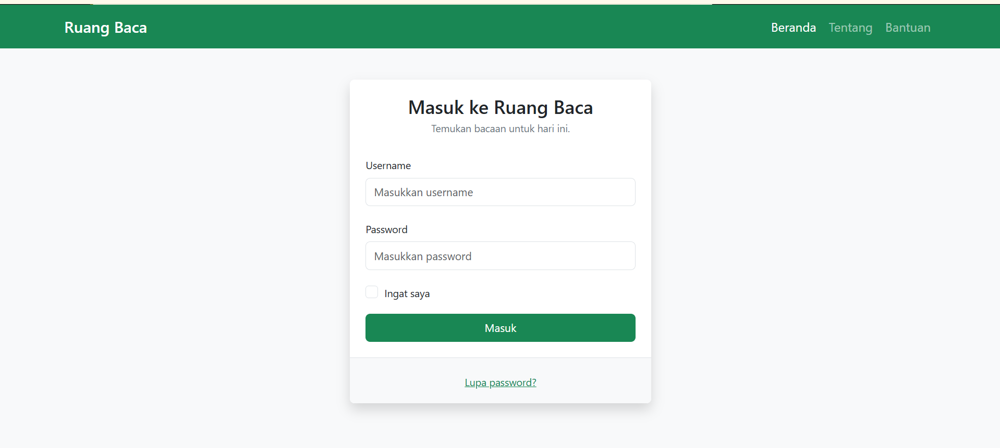
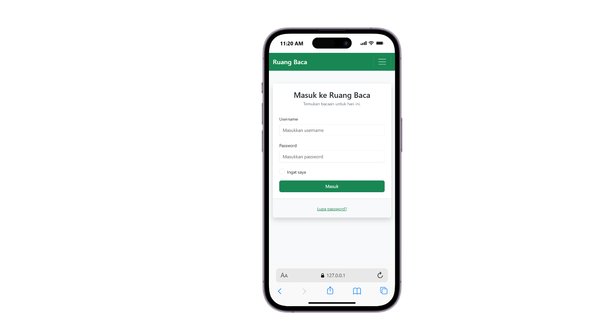

# Tugas Pendahuluan Modul 5 - Bootstrap

## 1. Pengertian Bootstrap

Bootstrap adalah framework CSS yang digunakan untuk membantu pembuatan tampilan website dengan lebih cepat. Bootstrap menyediakan komponen siap pakai, seperti navbar, tombol, form, dan sistem grid. Bootstrap juga mendukung desain responsif sehingga tampilan website dapat menyesuaikan ukuran layar perangkat.

## 2. Memasang Bootstrap

Bootstrap dapat digunakan dengan beberapa cara:

1. CDN, yaitu menghubungkan file CSS dan JavaScript Bootstrap melalui URL CDN.
2. Download, yaitu mengunduh file Bootstrap dan menyimpannya di dalam folder proyek.
3. NPM, yaitu memasang Bootstrap melalui Node Package Manager pada proyek yang menggunakan Node.js.

## 3. Grid dan Breakpoint

Grid Bootstrap adalah sistem tata letak yang membagi baris menjadi 12 kolom. Class seperti `container`, `row`, dan `col` digunakan untuk menyusun elemen pada halaman. Breakpoint adalah batas ukuran layar yang digunakan untuk menyesuaikan tata letak berdasarkan perangkat. Contohnya, `col-12` menggunakan seluruh lebar kolom, sedangkan `col-md-6` menggunakan setengah lebar mulai dari ukuran medium.

## 4. Class Bootstrap

- `container`: membuat wadah konten dengan lebar responsif.
- `row`: membuat baris dalam sistem grid.
- `col-md-6`: membuat kolom setengah lebar mulai ukuran medium.
- `btn btn-primary`: membuat tombol dengan warna utama.
- `form-control`: memberikan tampilan Bootstrap pada input form.
- `text-center`: membuat teks rata tengah.
- `shadow`: menambahkan bayangan pada elemen.

## 5. Gambar Responsif

Agar gambar menyesuaikan ukuran layar perangkat, gunakan class `img-fluid` pada elemen gambar. Class ini membuat lebar gambar maksimal 100% dari lebar wadahnya dan menjaga tinggi gambar secara otomatis.

Contoh:

## 6. Screenshot Hasil Program

Halaman login Ruang Baca dibuat menggunakan Bootstrap 5.3.8. Halaman ini memiliki navbar dengan nama Ruang Baca di sebelah kiri dan menu Beranda, Tentang, serta Bantuan di sebelah kanan. Form login berisi input Username, input Password, checkbox Ingat saya, tombol Masuk, dan tautan Lupa password?. Tata letak menggunakan komponen Bootstrap agar responsif pada layar kecil.

### Screenshot hasil tampilan browser

### Screenshot tampilan ponsel

