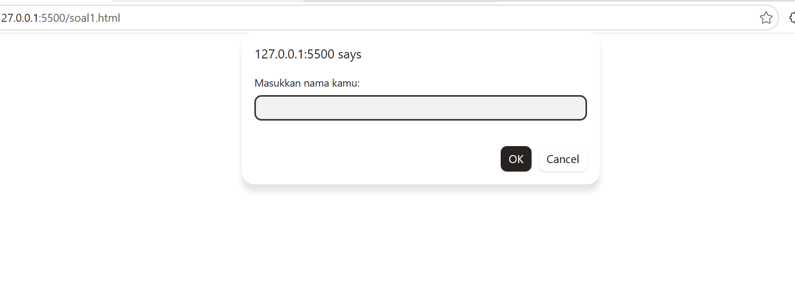
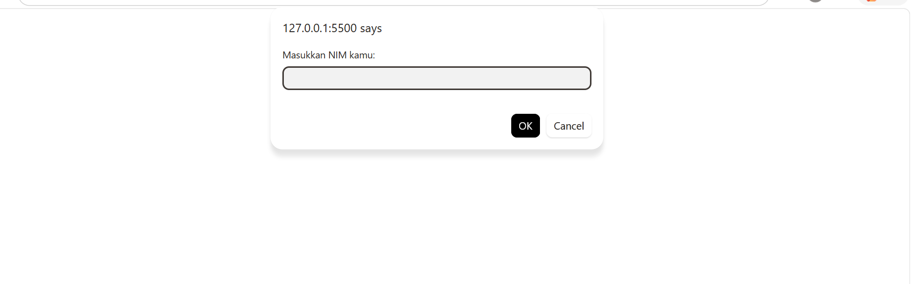
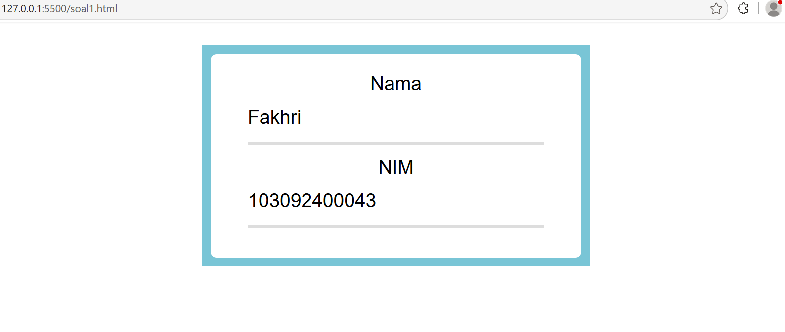
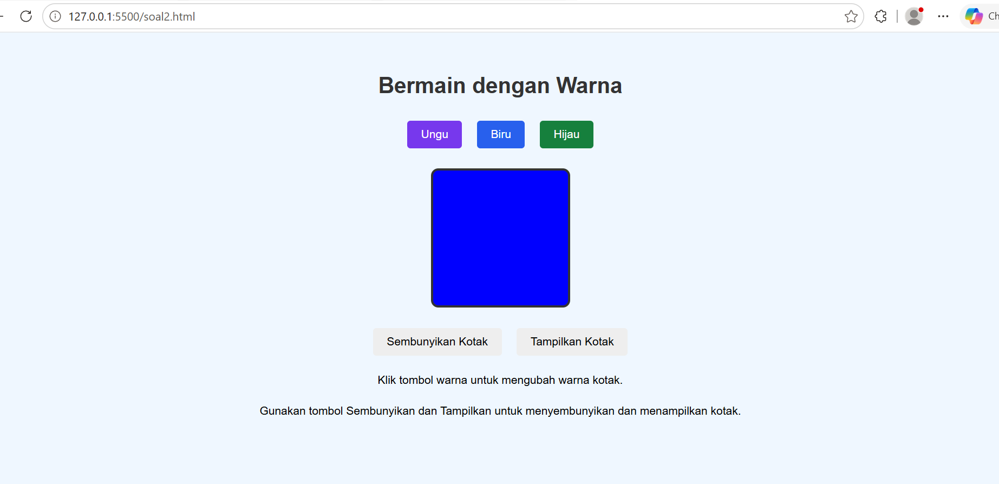
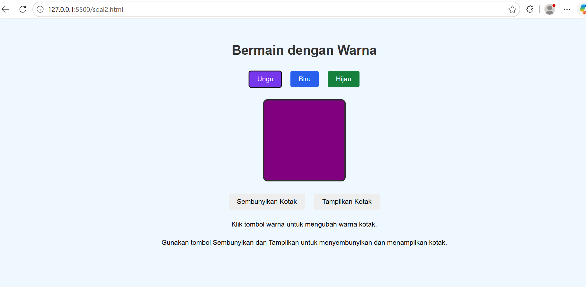
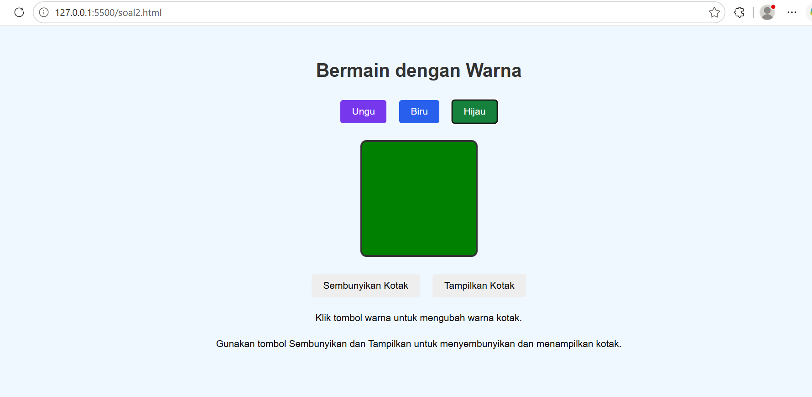
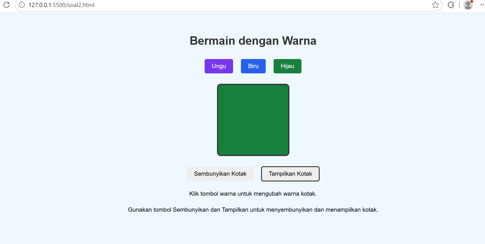
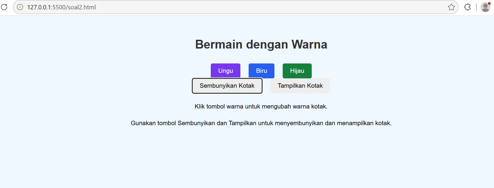

# Tugas Pendahuluan Modul 6
## Pemrograman Web - JavaScript dan jQuery

**Mata Kuliah:** Pemrograman Web  
**Modul:** 6 - JavaScript dan jQuery

### Soal 1 

JavaScript adalah bahasa pemrograman yang digunakan untuk membuat halaman web menjadi lebih interaktif. JavaScript dapat digunakan untuk menampilkan pesan, menerima input dari pengguna, mengubah isi halaman web, dan menjalankan perintah berdasarkan tindakan pengguna. Dengan JavaScript, website tidak hanya menampilkan informasi, tetapi juga dapat merespons interaksi pengguna.
### Soal 2 

jQuery adalah library JavaScript yang digunakan untuk mempermudah penulisan kode dalam pengembangan website. jQuery membantu programmer memilih dan mengubah elemen HTML, menangani tindakan pengguna seperti klik tombol, serta menambahkan efek seperti menyembunyikan dan menampilkan elemen. Dengan jQuery, beberapa fungsi yang membutuhkan kode JavaScript lebih panjang dapat ditulis dengan sintaks yang lebih sederhana.

### Soal 3 
Perbedaan JavaScript dan jQuery terletak pada pengertian dan cara penggunaannya. JavaScript merupakan bahasa pemrograman yang dapat digunakan secara langsung untuk membuat halaman web menjadi interaktif, sedangkan jQuery merupakan library yang dibangun menggunakan JavaScript untuk mempermudah penulisan kode. Contohnya, JavaScript dapat menggunakan document.getElementById() untuk memilih elemen HTML berdasarkan ID, sedangkan jQuery menggunakan sintaks $("#id"). Keduanya dapat digunakan untuk mengatur tampilan dan interaksi website, tetapi jQuery menyediakan cara penulisan yang lebih ringkas untuk berbagai operasi tertentu.

### Soal 4 

Program pada file `soal1.html` menggunakan fungsi `prompt()` untuk meminta nama dan NIM pengguna ketika halaman web dibuka. Setelah pengguna memasukkan kedua data tersebut, JavaScript menampilkan nama dan NIM pada halaman web.

Fungsi `document.getElementById()` digunakan untuk memilih elemen HTML berdasarkan ID, sedangkan `textContent` digunakan untuk menampilkan data sebagai teks pada halaman.

**Alur program:**
1. Halaman web dibuka.
2. Pengguna memasukkan nama melalui kotak dialog.
3. Pengguna memasukkan NIM melalui kotak dialog.
4. Nama dan NIM ditampilkan pada halaman web.

### Output 

### Soal 5 

Program pada file `soal2.html` membuat halaman web interaktif dengan judul *Bermain dengan Warna*. Halaman ini memiliki tiga tombol warna, yaitu Ungu, Biru, dan Hijau, serta tombol untuk menyembunyikan dan menampilkan kotak.

Fungsi yang digunakan antara lain:

- .click() untuk menjalankan perintah ketika tombol diklik.
- .css() untuk mengubah warna latar belakang kotak.
- .hide() untuk menyembunyikan kotak.
- .show() untuk menampilkan kotak kembali.
- $(document).ready() untuk menjalankan kode setelah struktur halaman HTML siap.

### Output Warna

### Output HIDE and SHOW

